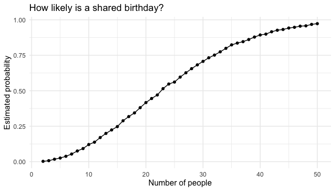
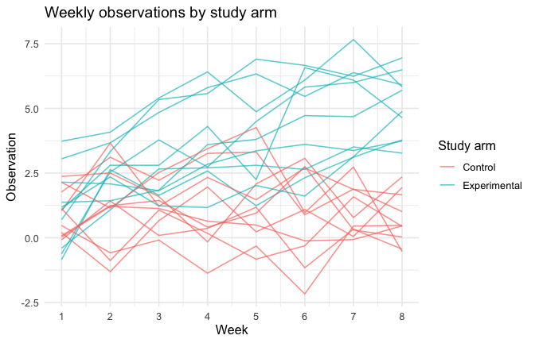
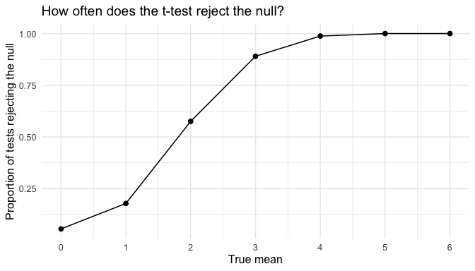
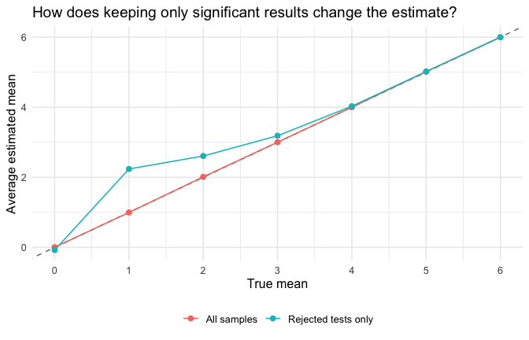

P8105 Homework 5
================
Xiaobo Shen

``` r
library(dplyr)
library(ggplot2)
library(purrr)
library(readr)
library(tidyr)
```

## Problem 1

I represented birthdays using the numbers 1 through 365. Then I sampled
with replacement so that more than one person could be born on the same
day.

``` r
set.seed(8105)

shared_birthday = function(group_size) {
  birthdays = sample(1:365, size = group_size, replace = TRUE)
  any(duplicated(birthdays))
}

birthday_sim =
  expand_grid(
    group_size = 2:50,
    iter = 1:10000
  ) |>
  mutate(
    shared = map(group_size, shared_birthday)
  ) |>
  unnest(shared)
```

Each row represents one simulated group. I averaged the TRUE/FALSE
results within each group size to estimate the probability of a shared
birthday.

``` r
birthday_prob =
  birthday_sim |>
  group_by(group_size) |>
  summarize(probability = mean(shared))
```

``` r
birthday_prob |>
  ggplot(aes(x = group_size, y = probability)) +
  geom_line() +
  geom_point(size = 1.5) +
  labs(
    title = "How likely is a shared birthday?",
    x = "Number of people",
    y = "Estimated probability"
  ) +
  theme_minimal(base_size = 12)
```

<!-- -->

With just 23 people, the chance of a shared birthday was already about
52%. It reached about 97% with 50 people. As the group gets larger,
there are more pairs of people who could share a birthday.

## Problem 2

Each CSV file contains eight weekly observations for one participant. I
used the filename to identify the study arm and participant ID.

``` r
participant_files =
  tibble(
    file_name = list.files("data", pattern = "[.]csv$"),
    path = file.path("data", file_name)
  ) |>
  mutate(data = map(path, read_csv, show_col_types = FALSE))
```

``` r
longitudinal_data =
  participant_files |>
  mutate(file_name = stringr::str_remove(file_name, "[.]csv$")) |>
  separate(file_name, into = c("arm", "subject_id"), sep = "_") |>
  mutate(arm = recode(arm, con = "Control", exp = "Experimental")) |>
  select(-path) |>
  unnest(data) |>
  pivot_longer(
    cols = starts_with("week_"),
    names_to = "week",
    names_prefix = "week_",
    values_to = "observation"
  ) |>
  mutate(week = as.integer(week))

longitudinal_data
```

    ## # A tibble: 160 × 4
    ##    arm     subject_id  week observation
    ##    <chr>   <chr>      <int>       <dbl>
    ##  1 Control 01             1        0.2 
    ##  2 Control 01             2       -1.31
    ##  3 Control 01             3        0.66
    ##  4 Control 01             4        1.96
    ##  5 Control 01             5        0.23
    ##  6 Control 01             6        1.09
    ##  7 Control 01             7        0.05
    ##  8 Control 01             8        1.94
    ##  9 Control 02             1        1.13
    ## 10 Control 02             2       -0.88
    ## # ℹ 150 more rows

``` r
longitudinal_data |>
  ggplot(aes(
    x = week, y = observation,
    group = interaction(arm, subject_id), color = arm
  )) +
  geom_line(alpha = 0.7) +
  scale_x_continuous(breaks = 1:8) +
  labs(
    title = "Weekly observations by study arm",
    x = "Week",
    y = "Observation",
    color = "Study arm"
  ) +
  theme_minimal(base_size = 12)
```

<!-- -->

The two groups overlap early in the study. Most experimental
participants have higher observations in the later weeks than at the
start. The control participants’ observations fluctuate over time, with
no consistent increase.

## Problem 3

For each true mean from 0 to 6, I generated 5,000 samples of size 30
from a normal distribution with a standard deviation of 5. I used a
two-sided one-sample t-test to test whether the population mean was
zero.

``` r
set.seed(8106)

simulate_t_test = function(true_mean) {
  sample_data = rnorm(30, mean = true_mean, sd = 5)

  broom::tidy(t.test(sample_data, mu = 0))
}

test_results =
  expand_grid(
    true_mean = 0:6,
    iter = 1:5000
  ) |>
  mutate(test_result = map(true_mean, simulate_t_test)) |>
  unnest(test_result) |>
  select(true_mean, iter, estimate, p.value) |>
  mutate(reject = p.value < 0.05)
```

For each true mean, I calculated the fraction of tests that rejected the
null and compared the average estimate before and after filtering by
statistical significance.

``` r
test_summary =
  test_results |>
  group_by(true_mean) |>
  summarize(
    rejection_rate = mean(reject),
    mean_all = mean(estimate),
    mean_rejected = mean(estimate[reject])
  )
```

``` r
test_summary |>
  ggplot(aes(x = true_mean, y = rejection_rate)) +
  geom_line() +
  geom_point(size = 2) +
  scale_x_continuous(breaks = 0:6) +
  labs(
    title = "How often does the t-test reject the null?",
    x = "True mean",
    y = "Proportion of tests rejecting the null"
  ) +
  theme_minimal(base_size = 12)
```

<!-- -->

When the true mean was zero, the test rejected about 5.5% of the time,
which is close to the 5% significance level. As the true mean moved
farther from zero, power increased. By a true mean of 4, the test
rejected about 99% of the time.

``` r
test_summary |>
  select(
    true_mean,
    `All samples` = mean_all,
    `Rejected tests only` = mean_rejected
  ) |>
  pivot_longer(
    cols = -true_mean,
    names_to = "sample_group",
    values_to = "average_estimate"
  ) |>
  ggplot(aes(x = true_mean, y = average_estimate, color = sample_group)) +
  geom_abline(slope = 1, intercept = 0, linetype = "dashed", color = "gray50") +
  geom_line() +
  geom_point(size = 2) +
  scale_x_continuous(breaks = 0:6) +
  labs(
    title = "How does keeping only significant results change the estimate?",
    x = "True mean",
    y = "Average estimated mean",
    color = NULL
  ) +
  theme_minimal(base_size = 12) +
  theme(legend.position = "bottom")
```

<!-- -->

The dashed line shows where the average estimate equals the true mean.
The average across all samples stayed close to this line because the
sample mean is unbiased. When the true mean was 1, the overall average
was about 1.00, but it was 2.24 among rejected tests. At small positive
true means, samples with unusually high means are more likely to give
significant results. At a true mean of 0, the two-sided test can select
extreme estimates in either direction, so the average among rejected
tests stays close to zero. At larger true means, nearly every test
rejects and the two averages are similar.
